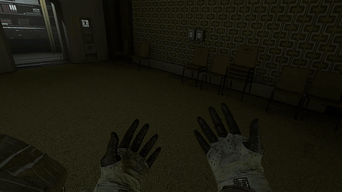

# Routine VR

Room-scale, 6DoF VR for **ROUTINE** (Lunar Software, Unreal Engine 5.5), built on
[UEVR](https://github.com/praydog/UEVR). Quest 3/3S first, with other headsets
added as small layout files.



What it adds on top of plain UEVR:

| Feature | How |
|---|---|
| 6DoF head + room-scale walking | UEVR `RoomscaleMovement` with collision sweep (your real steps move you, walls stop you) |
| Motion hands and body | The suit's own arms follow your controllers, attached at the body's shoulders, with finger curl from the triggers/grips. Look down and you see the suit's body (with the ID card on the chest) |
| Body follows your head | Turn your head past a dead zone and the character turns with you; the view itself never moves (dead zone and speed sliders) |
| C.A.T. in your hand | Grip to raise it: it sits in the glove the way the game holds it. Hold, toggle, or draw it from your hip like a holster. Put away, it hangs on your hip |
| Touch the C.A.T.'s buttons | Press its side buttons with your other index finger (the controller buzzes) |
| Aim with your hand | `AimMethod = Right Controller` (left in left-handed mode); turning stays smooth with the C.A.T. out |
| Left-handed mode | One checkbox swaps the C.A.T., aim, interact trigger, touch and grips |
| Physical crouch | Duck in real life and the game crouches (switch off under Room-scale) |
| Game menu | Tap Y |
| Recenter | Hold B + Y for 3 s (works in menus) or use the panel button; the mod also tries on its own at startup |
| Cutscenes and menus | Video cutscenes play around you in VR with your controls kept, menus use plain aim; an optional mode shows videos on a flat 2D screen |
| Headset auto-detect | The controller layout is picked from the headset UEVR finds: Quest Touch, Index, Pico, WMR, Vive wands |
| Comfort | Fisheye lens, film grain, vignette, motion blur, DoF, chromatic aberration and lens flares off; sharpen can go too (all switchable; fisheye/grain/sharpen need the PPV pak mod) |
| Rendering | Native Stereo with UEVR's Native Stereo Fix, so the C.A.T.'s screen shows in both eyes |

## What's in this repo

- `profile/Routine-Win64-Shipping/`: the UEVR profile (config and Lua
  scripts). This is the mod.
- `install-linux.sh` / `uninstall-linux.sh` and `install-windows.bat` /
  `uninstall-windows.bat`: copy the profile into UEVR's profile folder and
  take it out again. Installing merges into an existing UEVR `config.txt`
  and backs the original up; uninstalling puts it back. Your Routine VR
  settings are kept unless you ask to remove them.
- `tools/`: the scripts behind those, plus Linux setup helpers.
- `tests/run_tests.lua`: offline tests against a fake UEVR API.

Not included (get them from their authors):

- [UEVR](https://github.com/praydog/UEVR) (the nightly builds are used).
- KeinZantezuken's **PPV/SML** pak mod,
  [Visibility Tweaks on Nexus Mods](https://www.nexusmods.com/routine/mods/1) (optional, removes
  the fisheye, grain and sharpen effects; Routine VR drives its `rpp`
  console commands). Download its zip and pass it to the installer.

## Install on Windows

1. Install UEVR and its requirements (see the UEVR page).
2. Double-click `install-windows.bat`. To add the PPV pak mod as well, drag
   its zip onto `install-windows.bat` instead.
3. Start Routine, then inject with UEVR's injector as usual, using OpenXR.

To remove it, run `uninstall-windows.bat` (it also removes the PPV files).
To delete your Routine VR settings too, run
`powershell -ExecutionPolicy Bypass -File tools\windows\uninstall.ps1 -RemoveSettings`.

## Install on Linux (Steam, Proton, WiVRn)

Run on the host, not in a toolbox, from this folder:

```bash
./install-linux.sh --full
```

`--full` downloads the latest UEVR nightly (checksum-verified) to
`~/.local/share/routine-vr/uevr`, installs the .NET 6 Desktop Runtime into
Routine's prefix with protontricks (native or Flatpak), installs the profile,
and prints the launch options. Without `--full` it only installs the profile.
Add `--ppv path/to/PPV-....zip` to install the PPV pak mod too.

In Steam → Routine → Properties:

- **Compatibility:** force **Proton 11.0** (or Proton Experimental). Don't use
  Proton-Wineland: with a VR runtime present, its DXVK/vkd3d require
  `VK_WINE_openxr_device_extensions`, which its Wine won't offer on the GPU, so
  the game dies with "A D3D11-compatible GPU is required".
- **Launch Options:** what the installer prints, for example:

```
VR_OVERRIDE=/run/host/usr/lib64/xrizer/runtime PROTON_REMOTE_DEBUG_CMD="$HOME/.local/share/routine-vr/uevr/UEVRInjector.exe --attach=Routine-Win64-Shipping.exe" %command%
```

To remove it: `./uninstall-linux.sh` (add `--remove-settings` to delete your
Routine VR settings too), then clear the launch options.

Then:

1. Start WiVRn and connect the Quest.
2. Launch Routine from Steam. The UEVR injector opens with it and attaches by itself.
3. Leave the injector on **OpenXR** (UEVR → Proton's wineopenxr → WiVRn).
   `VR_OVERRIDE` is still needed so Proton's VR setup finds WiVRn through xrizer.
4. UEVR's own menu starts closed (the profile sets "Remember Menu State" with the menu closed). Click both sticks to open or close it.
   While it's open, it takes the sticks and buttons and the game gets nothing.
5. Load into the game and stand up straight for 3 seconds (height
   auto-calibrates). To recenter, hold B + Y for 3 seconds (both
   controllers buzz), or press **Recenter + recalibrate now** in the
   Routine VR panel.

If head tracking is jittery for a whole session, restart the game. On
some launches UEVR's frame tracking comes up broken (its log warns "maybe
previous frame was not rendered?" once a second) and only a restart fixes
it; the Routine VR panel's top line tells you when it sees this (installer
on Linux only for now, see the headset note below).

Video cutscenes play with the game still around you. UEVR doesn't render
videos in 3D, so they look flat on their in-game surface. **Comfort →
Cutscene mode** puts them on a flat 2D screen instead, but that switch has
crashed the game as a cutscene starts, so it's off by default.

## Manual install (no installer)

Each release has a `routine-vr-<version>-profile.zip` with just the mod: a
`Routine-Win64-Shipping` folder (UEVR's profile for the game).

- **Windows:** extract it into `%APPDATA%\UnrealVRMod\`, so you end up with
  `%APPDATA%\UnrealVRMod\Routine-Win64-Shipping\config.txt` and `scripts\`.
- **Linux (Proton):** extract it into
  `<Steam library>/steamapps/compatdata/606160/pfx/drive_c/users/steamuser/AppData/Roaming/UnrealVRMod/`.

If you already have a UEVR profile for Routine, back up its `config.txt`
first: the zip's `config.txt` replaces it (the installers merge instead).
To remove a manual install, delete `scripts\routine_vr`,
`scripts\routine_vr.lua` and `user_script.txt` from that folder (and
restore your `config.txt` backup).

## Headsets and controllers

The controller layout is picked automatically from the headset name UEVR
logs at startup, with the Linux installer (it links UEVR's log where the
mod is allowed to read it). Without that link, or on Windows for now, the
mod uses the Touch layout; you can choose one by hand in the panel's
Controllers section. Layouts: Meta Quest / Rift (Touch), Valve Index (also Bigscreen
Beyond, Varjo, Pimax), Pico, Windows Mixed Reality (Reverb and others), HTC
Vive wands (Vive Focus, XR Elite and Cosmos use the Touch layout).

With UEVR's default buttons (the default), UEVR maps every controller
itself, so buttons work on any of them. The layout covers the mod's own
reads (recenter chord, finger curl) and, on OpenVR only, a per-controller
aim pitch fix. Under OpenXR (the default) all controllers share the same
grip and aim poses, so the glove alignment carries over between them.

Only the Quest 3 has been tested so far. Controllers without B/Y recenter
with both stick/pad clicks held for 3 seconds instead of B + Y.

## The Routine VR panel

Click both thumbsticks to open UEVR's overlay; the **Routine VR** window
opens beside UEVR's own. The top line shows what the mod is doing and has
a recenter button; below it are collapsible sections:

| Section | What's in it |
|---|---|
| Controls | Left-handed mode, how the grip raises the C.A.T., lean, Y menu, stick movement and turning |
| Hands and body | Motion hands, the body, body follow, glove alignment, fingers and thumb |
| C.A.T. | The hip holster, touching its buttons, the laser pointer |
| Room-scale | Height calibration, physical crouch, recenter at start |
| Comfort | The camera effects the mod removes |
| Controllers | Controller layout (auto-detected) |
| Advanced | The recorder for bug reports, input check, body scan, attachments for use without motion hands |

Settings are saved in `<profile>/data/routine_vr.json`.

## Hands and the C.A.T.

**Motion hands** (on by default): the game's spacesuit arms follow your
controllers, running from the body's shoulders, so you see your own arms.
The index finger follows the trigger, the other fingers the grip, the thumb
curls when it's on the thumbrest or a face button, or pushing its stick. If the gloves don't line up with your real
hands, each has offset sliders under **Hands and body** → Glove alignment.

**Raising the C.A.T.:** reach to your right hip and grip to draw it, like a
holster (the controller buzzes when your hand is there); it stays out while
you hold the grip. In **Controls** the grip can be switched to
hold-anywhere, press-to-toggle or off. The C.A.T. sits in your glove the way the game holds it.

**Hip holster:** put away, the C.A.T. hangs on your hip (so it's out of
the way when crawling). Its position and angle have sliders in the
**C.A.T.** section, kept separately for right- and left-handed mode.

**Touch:** with the C.A.T. out, press one of its side buttons with your
other index finger (the controller buzzes). No need to inspect.

**Lean** (needed in the tutorial) is on your off hand's **trigger** (the
left one, right-handed). It used to be the grip, but that's easy to hold
without meaning to. In **Controls** lean can go back on the grip, or off;
then the trigger can send Focus (the game's D-pad up) instead. The C.A.T.'s
slow precise-aim turn is replaced by a steady turn (speed slider in
**Controls** → Turning with the C.A.T. out).

**Left-handed mode** (checkbox in **Controls**): the C.A.T., aim,
grip-raise and the hip holster move to the left hand, touch and lean to the
right, and the left trigger becomes interact.

**Body:** the suit's body is shown under you, head hidden, with the ID card
on the chest. **Body turns to follow your head** turns the character once
your head is past the dead zone; tune the dead zone and speed in **Hands
and body**.

With motion hands off, the mod falls back to UEVR attachments: the C.A.T.
and the pawn's `CameraComponent` (where Routine points and clicks from) go
on the controller, with sliders in **Advanced** → Controller attachments. UEVR's own
**UObjectHook** tab does the same job with more knobs.

## Default controls (Quest Touch, right-handed)

Buttons go through UEVR's own controller mapping; the mod adds a few
controls on top. Left-handed mode (panel, Controls) swaps the hands:
the C.A.T., aiming and grip-raise move to the left hand, touch and lean to
the right, and the left trigger becomes interact.

| Quest | Does |
|---|---|
| Right trigger | Interact / click (point with your right hand) |
| Right grip | At your hip: draw the C.A.T. (hold to keep it out; hold-anywhere or toggle in the panel) |
| Left index finger | Press the C.A.T.'s side buttons by touching them |
| Left trigger | Lean |
| Left grip | Curls the fingers (no game action) |
| Left X | Crouch |
| Right B | Interact |
| Tap Y | Game menu (Start) |
| Hold B + Y, 3 s | Recenter |
| Left stick click | Sprint |
| Left stick | Move toward where you look (raw stick in menus) |
| Right stick | Smooth turn (left/right only; look up and down with your head) |
| Both stick clicks | UEVR menu |

## Terminals and aiming

Your right hand is the game's camera direction: interaction traces, the
crosshair's real target and the flashlight follow it, not your head. To use
a terminal or pick something up, point your hand at it and pull the
trigger. A laser pointer can be switched on in the panel if you want to see
the exact line.

## Adding a headset

Copy `profile/Routine-Win64-Shipping/scripts/routine_vr/devices/quest_touch.lua`,
edit the `buttons`/`triggers` tables, add the id to `M.order` in
`devices/init.lua`, then run `tools/install-profile.sh`. See
[docs/DESIGN.md](docs/DESIGN.md).

## Resetting

Every UEVR setting and the mod's own settings live in the profile folder.
To start over, move that folder aside and reinstall:

```bash
P=~/.local/share/Steam/steamapps/compatdata/606160/pfx/drive_c/users/steamuser/AppData/Roaming/UnrealVRMod/Routine-Win64-Shipping
mkdir -p ~/.local/share/routine-vr/backups && mv "$P" ~/.local/share/routine-vr/backups/profile-$(date +%Y%m%d-%H%M%S)
./tools/install-profile.sh   # from this folder
```

Don't hold the right trigger while UEVR's menu is open. In UEVR that turns
the sticks into camera-offset controls. The mod puts the offsets back to 0
every half second, but it's still disorienting.

## Credits

- Nero's community UEVR profile for Routine was the base this mod was
  built from. It showed the `CameraComponent` attachment, the C.A.T.
  inspect swap, the cutscene detection, and the meshes to hide. Its libraries (`uevr_utils` and friends) credit markmon,
  Pande4360, Rusty Gere and lobotomy.
- KeinZantezuken's PPV/SML pak mod provides the `rpp` commands that switch
  off the fisheye, grain, and sharpen. The laser pointer uses the same
  capsule-component approach as the community profile's interaction laser
  (credited there as inspired by Gwizdek).

## Development

```bash
tools/install-profile.sh
```

copies the profile into the prefix. Keys in the repo's `config.txt` overwrite
the same keys in the installed one. Every other key UEVR wrote is kept, and
so is `data/` (your Routine VR settings and hand attachments).

Offline tests run the mod's Lua against a fake UEVR API:

```bash
lua tests/run_tests.lua
```

Any Lua 5.3+ works. On this machine:
`LD_LIBRARY_PATH=/run/host/usr/lib64 /run/host/usr/bin/luatex --luaonly tests/run_tests.lua`.

## Status

Beta. Written against UEVR nightly 01143's Lua API and Routine build
22236094, and played on a Quest 3 through Proton 11 + OpenXR + WiVRn. The
offline tests cover the mod's logic (277). Not tested yet: other headsets
(the layouts are there, but only Touch has been played) and the Windows
installer. Known issues are in [docs/TODO.md](docs/TODO.md).

## License

MIT, see `LICENSE`. UEVR and the PPV/SML pak mod are separate projects under
their own terms and are not included.
